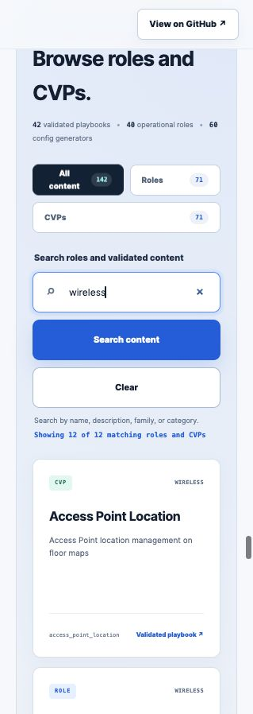

# Catalyst Center Ansible Field Guide

A static documentation portal for engineers learning and using the Cisco Catalyst Center Ansible collection. The site focuses on Workflow Manager modules and includes:

- A persistent left navigation organized for new and returning users
- Introductions to Ansible, Catalyst Center, the Python SDK, and the collection
- Current release highlights and a compatibility snapshot
- Secure installation guidance with no embedded credentials
- A working `site_workflow_manager` example
- A searchable catalog of 39 Workflow Manager modules
- A searchable catalog of all 1,551 collection modules
- A searchable library of 71 roles and 71 Cisco Validated Playbook projects
- Guidance on choosing modules, roles, validated playbooks, and config generators
- Curated official documentation, source repositories, whitepapers, videos, and labs



## Project structure

```text
.
├── index.html
├── assets/
│   ├── favicon.svg
│   ├── docs-preview.jpg
│   ├── content-catalog.js
│   ├── catalog-search.js
│   └── styles.css
├── .nojekyll
├── LICENSE
└── README.md
```

There is no build step, package manager, external font, analytics dependency, or third-party script. Two dependency-free local JavaScript files provide the catalog data, search, filtering, and incremental rendering.

## Preview locally

From the project directory:

```bash
python3 -m http.server 4173
```

Then open `http://127.0.0.1:4173/`.

## Information architecture

The left navigation follows this learning path:

1. **Introduction** — how the automation stack fits together
2. **What’s new** — current release and content highlights
3. **Installation** — supported runtime and collection setup
4. **First workflow** — one runnable Workflow Manager example
5. **Workflow managers** — featured modules and a searchable 39-manager catalog
6. **All modules** — search all 1,551 collection modules by operation name
7. **Roles & playbooks** — compare the options, then search all 142 role and CVP guides
8. **Compatibility** — controller, collection, and SDK alignment
9. **Resources** — official documentation, source, whitepapers, video, and lab

## Update the content

- Edit page copy, examples, and reference links in `index.html`.
- Edit colors, type, layout, and responsive behavior in `assets/styles.css`.
- Update search behavior or the embedded module inventory in `assets/catalog-search.js`.
- Regenerate `assets/content-catalog.js` from the collection catalog when roles or CVPs change.
- Use the production collection repository as the source for module names and examples.
- Check the latest release and compatibility matrix before updating version information.
- Update the “Links reviewed” date after checking every external reference.
- Keep credentials, controller addresses, customer data, and private examples out of this public repository.

## Publish with GitHub Pages

1. Create or select a GitHub repository.
2. Push these files to a branch.
3. Open **Settings → Pages**.
4. Under **Build and deployment**, select **Deploy from a branch**.
5. Select the publishing branch and the `/ (root)` folder, then save.

GitHub publishes a project site at `https://<account>.github.io/<repository>/`. A repository named `<account>.github.io` publishes at the account root.

## Security choices

- No credentials or tokens are stored in the site.
- Examples use the collection’s `CATALYSTCENTER_*` environment variables and direct readers to Ansible Vault or a CI secret store.
- TLS verification remains enabled in the example.
- Search uses a first-party, dependency-free script and safe DOM APIs; no third-party scripts are loaded.
- A restrictive Content Security Policy is declared in the HTML.
- External links opened in a new tab use `rel="noopener noreferrer"`.

## Primary sources

- [Catalyst Center Ansible collection](https://github.com/cisco-en-programmability/catalystcenter-ansible)
- [Catalyst Center Python SDK](https://github.com/cisco-en-programmability/catalystcentersdk)
- [Catalyst Center API documentation](https://developer.cisco.com/docs/catalyst-center/)
- [Ansible getting started documentation](https://docs.ansible.com/projects/ansible/latest/getting_started/index.html)

## License

The website code and original copy in this repository are available under the [MIT License](LICENSE). Linked Cisco documentation, source repositories, videos, product names, and trademarks retain their respective ownership and licenses.
